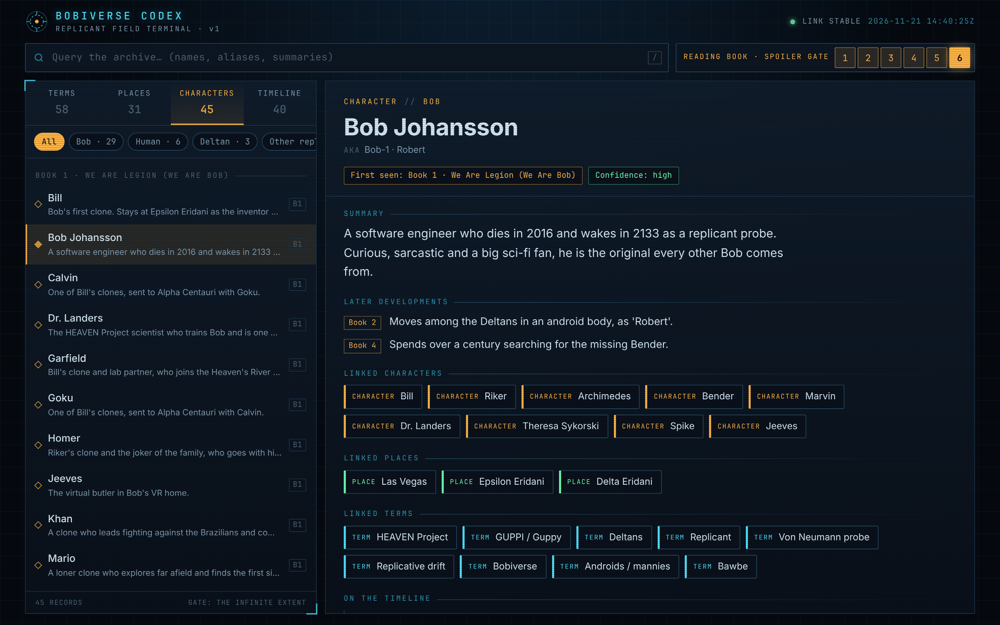

# Bobiverse Codex

A personal, spoiler-aware reference for the Bobiverse books: terms, places, characters and a timeline, each with a short summary. Pick the book you're on and anything later stays hidden.

Unofficial fan project for personal use. Not affiliated with the author or publisher.

**Live:** https://rikvanderkemp.github.io/Bobiverse/ · Star Map: https://rikvanderkemp.github.io/Bobiverse/map.html

## How it fits together

| Path | What it is |
| --- | --- |
| `index.html` | The built app: one self-contained HTML file (no external requests). |
| `src/template.html` | The app's HTML/CSS/JS with a `__DATA__` placeholder. |
| `map.html` / `src/map.html` | The Star Map: an interactive mind map of how characters, places, terms and references link up. Built the same way, no external libraries. |
| `src/build_bobiverse.py` | Source of all entries, summaries, per-book updates, timeline years and pop-culture references. |
| `data/bobiverse.json` | Generated data (don't edit by hand). |
| `build.py` | Regenerates the JSON and inlines it into `index.html` and `map.html`. |
| `.github/workflows/pages.yml` | Rebuilds and deploys to GitHub Pages on every push to `main`. |

## Editing

1. Change entries in `src/build_bobiverse.py` (or the UI in `src/template.html`).
2. Run `python3 build.py`.
3. Commit and push to `main`; Pages redeploys automatically.

**Spoiler rule:** an entry's `summary` may only state what's known by its `firstBook`. Anything revealed later goes in a `later(id, book, text)` update so the spoiler gate can hide it.
